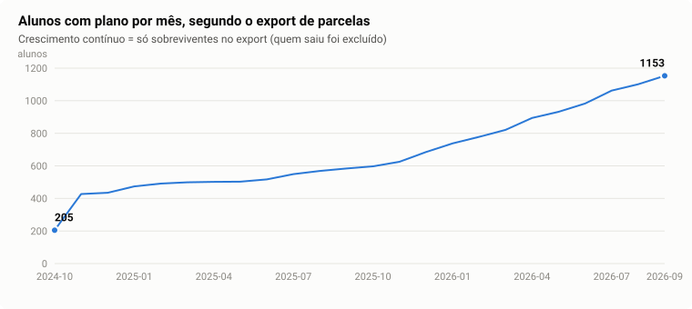
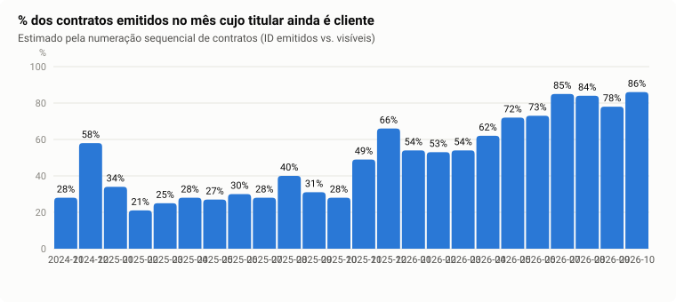
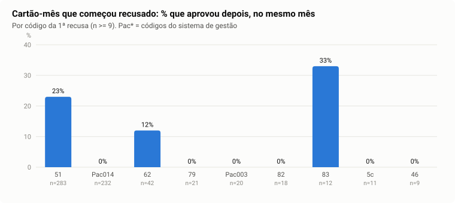
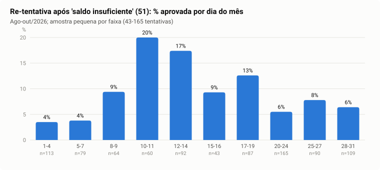
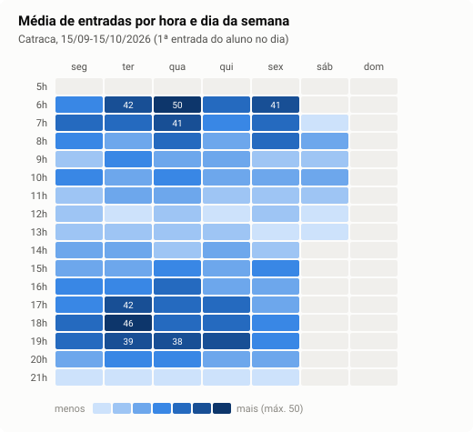

# Estudo dos dados da Academia Equilíbrio e Movimento: caminhos para o PIM II e o PIM III

> **Natureza do documento:** estudo exploratório e de planejamento. Não propõe implementação ainda.
> **Dados analisados:** exports reais do sistema de gestão da academia, extraídos em 15/10/2026 (não incluídos neste repositório).
> **Data do estudo:** 29/10/2026.
> **Privacidade:** este documento e a pasta `saidas/` contêm **apenas agregados**. Nenhum nome, CPF, e-mail, telefone ou matrícula foi copiado para cá.

---

## 0. Resumo executivo

1. **O export de parcelas só contém quem é cliente ativo hoje (viés de sobrevivência).** Quem saiu da academia foi excluído do relatório. Assim, **não é possível medir churn diretamente com esse arquivo**, e qualquer modelo de churn treinado nele aprende o padrão errado. Evidências na [seção 5](#5-o-achado-mais-importante-o-export-só-tem-sobreviventes).
2. **Parcela "Cancelada" não indica que o aluno saiu**, como o grupo suspeitava. Neste export, 93,5% dos alunos que o rótulo do PIM I ("tem ≥1 parcela cancelada") marcaria como churn **continuam com plano ativo**. Cancelamentos vêm de trocas de plano, renovações antecipadas (sair de uma promoção para entrar na seguinte) e saídas temporárias. Na [seção 4](#4-trocas-de-plano-como-tratar-antes-de-assumir-qualquer-coisa) há uma regra baseada em **cobertura aluno × mês** que resolve isso.
3. **A "inadimplência" desta academia é, na prática, falha de cobrança no cartão recorrente.** Só 30% das tentativas são aprovadas. Em set/2026, **30% dos cartões cobrados (240) passaram o mês inteiro sem aprovar, somando R$ 42,6 mil**. Essas falhas consumiram 65% de todas as tentativas do mês. A chance de recuperar **depende do código de recusa**: 23% para "saldo insuficiente" e ~0% para outros códigos, que mesmo assim são re-tentados dezenas de vezes. Há também um efeito de **dia do mês**: a re-tentativa após saldo insuficiente aprova 3–4% nos dias 1–7 e 17–20% nos dias 10–14. É o problema mais bem documentado nos dados de hoje e tem valor em R$ mensurável.
4. **Há sinais de engajamento e de jornada que ninguém está olhando.** 16,7% dos alunos pagantes não passaram na catraca nenhuma vez no mês. Alunos de planos promocionais (Black Friday/Natal) são os menos engajados (31% sem nenhum acesso). 23% dos alunos ativos hoje já saíram por ≥2 meses e voltaram. Um mesmo plano tem até 14 preços diferentes.
5. **Recomendação:** organizar o projeto como **inteligência do ciclo de vida do aluno**, com uma base comum (tabela de estados aluno × mês) e dois módulos analíticos:
   **(PIM II) recuperação de cobrança recorrente**, com os dados que já temos, e
   **(PIM III) retenção com análise de sobrevivência**, que depende de um novo export com ex-alunos e histórico de acessos longo, a ser pedido **agora**.
   Detalhes na [seção 8](#8-recomendação-e-roteiro).

---

## 1. Contexto e objetivo

- **PIM I (jun/2026):** classificador de churn (XGBoost, ROC-AUC 0,849) com rótulo "aluno tem ≥1 parcela Cancelada", sobre uma extração de 4.364 alunos e 71.321 parcelas. Também houve uma proposta revisada, focada em prevenção de inadimplência com alertas explicáveis (relatório PDF e pitch de extensão nesta pasta).
- **Pedido para este estudo:** analisar os dados reais atuais, descobrir os melhores caminhos (não necessariamente churn/inadimplência), tratar corretamente as trocas de plano e documentar o processo. Ainda não é hora de construir a solução.
- **Fora do escopo:** o código e os dados da versão anterior do projeto (`app.py`, `routes/`, `data/raw/...`). Estão desatualizados e não foram usados.

---

## 2. Inventário dos dados

| Arquivo | O que é | Período | Volume | Chave do aluno | Observações |
|---|---|---|---|---|---|
| `ParcelaEmAbertoRel-1792106356522.xlsx` | Parcelas (mensalidades, avulsas, acertos) | vencimento 15/10/2024 → 15/10/2026 | 19.875 parcelas · 1.244 alunos · 2.648 contratos de plano | `Matrícula` | Pago 18.625 · Cancelado 1.048 · Em Aberto 202. **Só alunos ativos na data do export** (seção 5). |
| `ListaAcessoRelCliente-...xlsx` | Catraca (entradas) | 15/09/2026 → 15/10/2026 | 9.228 registros · 1.081 alunos | `Mat. cliente` (mesma numeração) | 92,6% por reconhecimento facial. Só 12 registros de saída, então mede frequência, não tempo de permanência. `Situação` reflete o status **atual** do aluno. |
| `1792107164615-...xlsx` | Tentativas de cobrança no cartão (Cielo, recorrência) | 15/08/2026 → 15/10/2026 | 4.347 tentativas · 908 cartões | **nenhuma** (só nome do titular e cartão mascarado) | 29,8% aprovadas. Código de retorno da adquirente e códigos `Pac*` do sistema de gestão. |
| `ParcelaEmAbertoRel-1792104839312.xlsx` | — | — | **vazio (2 bytes)** | — | Export falhou. |
| `RelatorioClientes-...xlsx` | Cadastro de clientes | — | **vazio (2 bytes)** | — | Export falhou. **É o arquivo mais importante para pedir de novo** (seção 9). |
| PDFs / PPTX | Relatório da proposta, pitch PIM I, pitch de extensão | — | — | — | Usados só como contexto. |

**Ligação entre as bases:**
- Parcelas ↔ acessos pela matrícula: 1.025 alunos em comum. 219 alunos com parcela não passaram na catraca. 56 alunos passaram na catraca mas não estão nas parcelas, e 54 deles estão com situação "Inativo".
- Transações ↔ parcelas **não têm chave**. Montei um vínculo por *dia + valor + similaridade de nome* (seção 3, passo 3): 63% das transações aprovadas ancoradas e 433 cartões ligados a uma matrícula.

---

## 3. Processo (o que foi feito, em ordem)

Tudo é reproduzível pelos scripts em [`scripts/`](scripts/). O cache intermediário (com PII) fica **fora** do repositório.

```bash
cd scripts
python 00_carregar.py <pasta_com_os_xlsx> <pasta_cache_fora_do_repo>   # lê os 3 xlsx -> pickles
python 01_cobertura_e_eventos.py <pasta_cache>           # painel aluno x mês + eventos de contrato
python 02_vincular_transacoes.py <pasta_cache>           # transações de cartão -> matrícula
python 03_analises.py <pasta_cache>                      # todos os números deste documento -> saidas/
```

| Passo | O que fiz | O que aprendi / decisão |
|---|---|---|
| 1. Leitura do contexto | Li o relatório da proposta, o pitch do PIM I e o pitch de extensão. | O rótulo do PIM I é "≥1 parcela cancelada". Era preciso testar se isso representa saída. |
| 2. Perfil das bases | Tipos, nulos, domínios e períodos de cada coluna. | Dois arquivos vazios. Janelas curtas em acessos (1 mês) e transações (2 meses). |
| 3. Semântica dos campos | Comparei `Pagamento − Vencimento` por forma de pagamento. Isolei o `Contrato 0`. Cruzei a flag `Recorrência` com o nome do plano. | `Pagamento` **não** é a data em que o aluno pagou a mensalidade, no caso de cheque e cartão parcelado (detalhes abaixo). |
| 4. Estrutura de contratos | Montei a tabela por contrato (início, fim, parcelas pagas/canceladas) e li linhas do tempo reais. | Cancelamentos aparecem em bloco nas parcelas finais, quando um contrato é substituído. |
| 5. Painel de cobertura | Para cada aluno, o conjunto de meses cobertos por **qualquer** contrato (seção 4). | Permite separar troca, renovação e saída. |
| 6. Teste de sanidade | Contei alunos com plano por mês. | Crescimento monotônico de 205 para 1.153: **viés de sobrevivência** (seção 5). |
| 7. Numeração sequencial | Verifiquei se `Contrato` e `Matrícula` crescem com o tempo. | `Contrato` é sequencial (Spearman 0,99996). As lacunas na numeração permitem **estimar retenção por coorte** mesmo só com sobreviventes. |
| 8. Transações | Taxa de aprovação, re-tentativas, códigos, dia do mês, BIN. | Recuperação depende fortemente do código. Há efeito de dia do mês. |
| 9. Vínculo transação → aluno | 1ª tentativa: limiar de nome. Resultado: 47% das aprovadas. Diagnóstico: data e valor batem quase 1:1, mas o titular muitas vezes é outra pessoa. 2ª tentativa: pareamento 1-para-1 por dia+valor, com nome só desempatando. | 63% das aprovadas ancoradas. 19 cartões pagam mais de um aluno (família). |
| 10. Acessos | Mapa hora × dia, frequência, pagantes sem acesso, frequência por plano. | Sinal útil para engajamento. Ainda não validado como preditor de saída (seção 6.3). |
| 11. Validações | Rótulo do PIM I contra cobertura e catraca. Frequência de quem ficou inativo contra quem continuou ativo. | O rótulo do PIM I falha. Com 1 mês de acessos não há sinal antecipado detectável. |
| 12. Pesquisa externa | Busquei o significado dos códigos `Pac*` e as regras de re-tentativa das bandeiras. | `Pac*` não tem documentação pública: perguntar ao suporte do sistema. As bandeiras limitam re-tentativas e a Cielo prevê tarifa de retentativa. |

### 3.1 Achados de qualidade e semântica (o "dicionário escondido")

| Campo / item | Achado | Implicação |
|---|---|---|
| `Pagamento` | Em **cheque**, a mediana é 182 dias **antes** do vencimento (cheques pré-datados recebidos na venda). Em **cartão de crédito**, a média é −62 dias (parcelado na venda). Só cartão recorrente, PIX, débito e dinheiro refletem o pagamento mês a mês. | "Atraso médio" calculado em todas as formas de pagamento mistura conceitos. O atributo `atraso_medio_dias` do PIM I foi afetado. |
| `Situação = Cancelado` | Nenhuma parcela cancelada tem data de pagamento. Elas se concentram nas parcelas 8–12 do contrato. | Significa "restante do contrato anulado", seja por troca, renovação, saída ou trancamento. |
| `Contrato = 0` | 1.615 linhas de vendas avulsas, diárias e acertos de conta corrente, sem plano. | Separar das mensalidades. É receita acessória: R$ 5,2 mil/mês em média (out/25–set/26). |
| `Recorrência` (Sim/Não) | Em 90% dos contratos de planos com "RECORRÊNCIA" no nome, a flag é "Não". | Flag não confiável. Usar o nome do plano ou `Forma Pgto = CARTÃO RECORRENTE`. |
| `Faturamento` | Constante dentro do contrato (2.506 de 2.648): é a data de lançamento do contrato. | Serve como data de início do contrato, não de cobrança mensal. |
| Tipos de `Parcela` | Além de `PARCELA n`: RENEGOCIADA (463), PRODUTOS, MATRÍCULA, MANUTENÇÃO MODALIDADE, ANUIDADE, TRANSFERÊNCIA. | Só `PARCELA n` / renegociada / transferência contam como mensalidade de cobertura. |
| Parcela única de valor alto | Ex.: Gold por R$ 1.124 em uma parcela. | Pagamento à vista de vários meses. Expandido para ~`valor / R$ 190` meses (premissa a confirmar). |
| Acessos: `Situação` | É o status atual, não o status no momento do acesso. | Quem aparece "Inativo" acessou na janela e saiu depois: uma pequena amostra de saídas reais. |
| Transações: horário | 4.292 de 4.347 tentativas às 12h. | O sistema roda um lote diário de cobrança. |
| Transações: tentativas por cartão | Intervalos de 0 a 4 dias entre tentativas, até 65 tentativas em 2 meses. | Política de re-tentativa agressiva e cega ao código de recusa. |

---

## 4. Trocas de plano: como tratar antes de assumir qualquer coisa

### 4.1 O que acontece no sistema

Quando o aluno troca de plano (ex.: Natação 3x → Gold + Natação 3x → Gold) ou renova antes do fim (ex.: sai do *Black Friday 2024* para entrar no *Deu a Louca no Papai Noel 2024*), o sistema **cancela as parcelas restantes do contrato antigo** e **abre um contrato novo**. Olhando cada contrato isoladamente, parece um cancelamento. Olhando o aluno, ele nunca saiu.

### 4.2 A regra proposta: estado do aluno pela **cobertura**, não pelo status do contrato

1. **Mês coberto** = existe, em **qualquer** contrato do aluno, uma parcela de mensalidade **não cancelada** (Pago ou Em Aberto) com vencimento naquele mês. Pagamento à vista de vários meses é expandido.
2. **Evento de cada contrato**, a partir do último mês que ele cobre:

| Status | Definição | Contratos | Com parcela cancelada |
|---|---|---|---|
| `troca_ou_renovacao` | o aluno segue coberto e um contrato novo começa até 1 mês após o fim deste | 94 | 94 |
| `renovacao` | idem, sem nenhuma parcela cancelada | 694 | 0 |
| `coberto_por_contrato_sobreposto` | o aluno segue coberto por outro contrato iniciado antes | 295 | 8 |
| `saida_com_cancelamento` | parcelas canceladas e **≥2 meses sem cobertura** depois | 91 | 91 |
| `saida_sem_renovar` | o contrato terminou, ninguém renovou, ≥2 meses sem cobertura | 268 | 0 |
| `em_curso_ou_censurado` | ainda não há meses suficientes para observar o que veio depois | 1.206 | 5 |

3. **Saída (churn)** = aluno sem cobertura por **≥ N meses consecutivos**. Usei N = 2 como valor provisório. Lacunas de 1 mês (278 alunos) parecem ser mudança de dia de vencimento ou trancamento, não saída. **N deve ser calibrado com a academia**: a partir de quando ela considera um aluno desistente? Como o trancamento ("férias") aparece nas parcelas?
4. **Censura:** meses recentes sem tempo de observação **não** recebem rótulo. Por isso a abordagem natural é **análise de sobrevivência** (tempo até a saída, com censura), e não classificação binária.
5. **Voluntário × involuntário:** se os últimos meses antes da saída têm parcelas Em Aberto e recusas de cartão, a saída provavelmente foi involuntária (falha de cobrança), o que pede uma ação diferente da de quem desistiu.

### 4.3 Teste do rótulo do PIM I

| | Valor |
|---|---|
| Alunos com ≥1 parcela cancelada ("churn" pelo PIM I) | 168 de 1.243 (13,5%) |
| …desses, **ainda com plano em set/2026** | **93,5%** |
| …desses, que passaram na catraca como "Ativo" no último mês | 78,0% (entre os negativos: 83,1%) |
| Trocas com cancelamento em que o plano seguinte é **exatamente o mesmo** | 11% (nos outros 89% houve mudança real de plano) |

**Conclusão:** "parcela cancelada" é um marcador de **mudança de contrato**, não de saída. As métricas do PIM I precisam ser revistas com a nova definição. Observação: a extração do PIM I era outra e provavelmente incluía ex-alunos, então a taxa de 41,5% misturava saídas reais com trocas.

---

## 5. O achado mais importante: o export só tem sobreviventes



**Evidências:**
- Os alunos com plano crescem **monotonicamente** de 205 (out/24) para 1.153 (set/26). Uma academia com rotatividade normal oscila. Uma curva assim é o que se vê quando o relatório traz só quem está ativo hoje, olhando para trás.
- Dos 1.243 alunos, só 41 têm o último mês de cobertura antes de set/2026.
- 54 dos 56 alunos que aparecem na catraca mas não nas parcelas estão "Inativos": saíram durante o mês e **foram excluídos do relatório de parcelas**.
- A numeração dos contratos tem enormes lacunas (próximo item).

**O que isso invalida:** treinar churn neste arquivo; calcular taxa de cancelamento ou de inadimplência histórica; comparar planos por "quanto cancelam".
**O que continua válido:** fotografia atual (receita de set/26, preços, mix), trocas e renovações de quem ficou, cobrança recorrente e acessos.

### 5.1 Estimativa de retenção pelas lacunas da numeração

Como o número do `Contrato` é sequencial no tempo, a faixa de IDs de cada mês mostra **quantos contratos foram emitidos**. A quantidade visível no export mostra **quantos pertencem a quem ainda é cliente**.



| Idade do contrato (meses até out/26) | % de contratos cujo titular ainda é cliente |
|---|---|
| 0–3 (jul–out/26) | 78–86% |
| 4–6 (abr–jun/26) | 62–73% |
| 7–11 (nov/25–mar/26) | 49–66% |
| 12–23 (nov/24–out/25) | 21–40% (exceção: dez/24 com 58%, mês da promoção de Natal 2024) |

O mesmo raciocínio com matrículas novas (topo da sequência) mostra quantos cadastros de cada trimestre ainda estão ativos: 2025-T3 **16%**, 2025-T4 **21%**, 2026-T1 **30%**, 2026-T2 **35%**, 2026-T3 **42%**. Mesmo os cadastros mais recentes ficam abaixo de 50%. Isso sugere que **muitas matrículas são de visitantes, aulas experimentais ou leads que nunca converteram**: há um funil de conversão escondido aqui.

**Ressalvas:** a estimativa é aproximada. Os IDs podem ser consumidos por vendas estornadas ou contratos de não alunos, e a unidade é o contrato, não o aluno. Serve para dimensionar o problema, não para substituir o dado real.

---

## 6. Achados por tema

### 6.1 Cobrança recorrente: o problema que já está nos dados

| Indicador (15/08–15/10/2026) | Valor |
|---|---|
| Tentativas aprovadas | 29,8% |
| Cartão-mês que aprovou dentro do mês | 66,6% (604 de 1.809 nunca aprovaram) |
| **Set/26:** cartões cobrados / sem aprovação no mês | 804 / **240 (30%)** · **R$ 42,6 mil** · 65% de todas as tentativas do mês |
| Recusas em cartões que **nunca** aprovaram na janela | 2.621 de 3.050 (86%), em 238 cartões |
| Cartões com >15 recusas em 30 dias | 37 (>10: 78) |
| Parcelas de planos recorrentes pagas por **outro meio** | 29% (PIX 12%, crédito 12%, débito 3%), possivelmente no balcão após falha |
| Parcelas em aberto | 202 parcelas · 128 alunos · R$ 32,6 mil · atraso mediano de 18 dias · 94% no convênio de recorrência |

**A recuperação depende do código da 1ª recusa:**



- **51** (saldo/limite insuficiente): 23% recuperam no mês. **Vale re-tentar, no dia certo.**
- **Pac014** (código do sistema de gestão, significado não documentado publicamente), **79, 82, Pac003, 5c, 46**: **~0%** de recuperação, mas seguem sendo re-tentados por semanas. Pela documentação das adquirentes, vários desses códigos são "irreversíveis": a mesma transação nunca vai passar sem mudar o cartão.
- As bandeiras (Visa, Mastercard, Elo) **limitam o número de re-tentativas** de transações negadas, e o contrato da Cielo prevê **tarifa de retentativa** quando o limite é excedido. Os números exatos por bandeira devem ser confirmados com a Cielo. Os 37 cartões com mais de 15 recusas em 30 dias provavelmente estão acima desse limite.

**Efeito "dia do pagamento":**



Depois de uma recusa por saldo insuficiente, a re-tentativa aprova 3–4% nos dias 1–7 e **17–20% nos dias 10–14**. Hipótese: salário e fechamento da fatura no início do mês. A amostra por faixa é pequena (43–165 tentativas), então é preciso confirmar com mais meses. O emissor também importa: entre os 10 BINs mais frequentes, a aprovação varia de 2% a 46%.

**Leitura:** nesta academia, a "inadimplência" é sobretudo **churn involuntário**, ou seja, gente que quer continuar mas cujo cartão falha. É um problema clássico de negócios de assinatura, com ação clara: parar de re-tentar códigos irreversíveis, re-tentar "saldo insuficiente" nos dias com maior chance de aprovação, e pedir troca de cartão ou PIX cedo para quem tem código irreversível.

### 6.2 Inadimplência "real"

Só 202 parcelas em aberto (~1% das parcelas), quase todas recentes e no cartão recorrente. Não há sinal de um problema grande de calote, e sim de **falha operacional de cobrança**. Ressalva importante: quem deixou de pagar e foi desligado **não está no export** (seção 5), então o tamanho real da inadimplência só aparece com o export completo.

### 6.3 Engajamento (catraca)

| Indicador (15/09–15/10/2026) | Valor |
|---|---|
| Frequência mensal (dias distintos) | mediana 7 (p25 4, p75 10) |
| Alunos com plano em set/26 **sem nenhum acesso** no mês | **193 (16,7%)**, mais 125 com só 1–2 acessos |
| Planos promocionais (BF/Natal) | mediana **3,5** dias, **31% sem acesso** |
| Gold regular | mediana 7 dias, 19% sem acesso |
| Natação/Hidro | mediana 5 dias, 8% sem acesso (coerente com 1x–3x/semana) |
| Horário especial (11h–16h) | 24% das visitas **fora da faixa** contratada (17 alunos, 155 visitas) |
| Trancamentos | "Retorno - Férias" (53 alunos) e "Retorno - Atestado" (31) aparecem na catraca |

**Validação honesta:** comparei quem ficou inativo durante a janela com quem continuou ativo. A frequência nas 2 primeiras semanas foi **igual** (3,5 vs 3,7 dias). Só a recência difere (13,5 vs 5 dias sem vir), e isso é quase tautológico. **Com 1 mês de catraca não dá para afirmar que a queda de frequência antecede a saída.** O sistema guarda o histórico completo de acessos: pedir 12–24 meses resolve isso.

### 6.4 Ocupação



Picos às **6h–8h** e **17h–19h**, com terça e quarta mais cheias (até 50 entradas/hora às 6h de quarta). Sábado só de manhã, domingo fechado. O vale de 12h–14h coincide com o plano "Horário especial", que existe exatamente para deslocar demanda. Isso abre espaço para previsão de ocupação, planejamento de equipe, grade de aulas e raias da piscina.

### 6.5 Jornada entre planos, promoções e retornos

- **Transições observadas (788 trocas/renovações):** Gold → Gold 282; Natação → Natação 217; **Promo → Gold 94 de 128** (as promoções viram plano regular entre quem ficou); Natação → Gold + extra 20; Gold → Gold + extra 15; Gold + extra → Gold 17. Matriz completa em `saidas/E_matriz_transicao_planos.csv`.
- **Retornos:** 282 dos alunos ativos hoje (23%) já ficaram ≥2 meses sem plano e voltaram. Reativar ex-alunos é uma fonte relevante de receita. Não dá para dizer quantos ex-alunos *não* voltaram sem o export completo.
- **Promoções atraem um público menos engajado** (6.3). Se isso se confirmar com dados completos, é a pergunta central sobre promoções: o desconto traz alunos que ficam ou alunos que somem?

### 6.6 Receita e preço (fotografia de set/2026, sem viés)

| Indicador | Valor |
|---|---|
| Alunos faturados / receita de mensalidades | 1.111 · **R$ 188,2 mil** |
| Ticket médio por aluno | R$ 169,38 |
| "Plano Gold (Recorrência)" | 447 alunos, **14 preços distintos** (mín. R$ 99,90; mediana R$ 159,90) |
| "Natação ou Hidro 1x 2x 3x" | 129 alunos, 31 preços distintos |
| Mix de pagamento (out/24 → out/26) | recorrente 49% → 58%; cheque 23% → 13%; PIX 4% → 10% |
| Vendas avulsas | R$ 5,2 mil/mês em média (R$ 2,4 mil – R$ 8,1 mil); valores mais comuns: R$ 18, R$ 99,90, R$ 60, R$ 55 |

A dispersão de preços vem de reajustes, preços legados e promoções. Isso abre perguntas de **gestão de preço** (quanto da base está em preço antigo? quem renova a preço cheio?), sempre com cautela, porque reajustar o aluno fiel também pode causar saída.

---

## 7. Oportunidades de projeto

Avaliação de cada caminho. "Dados hoje" se refere ao que está nesta pasta.

| # | Oportunidade | Valor para a academia | Dados hoje | Potencial de ciência de dados / ML | Como medir sucesso | Principal risco |
|---|---|---|---|---|---|---|
| **A** | **Recuperação de cobrança recorrente** (churn involuntário) | **Alto**: R$ 42,6 mil/mês sem aprovação no cartão; tentativas e tarifas desperdiçadas | **Suficientes para começar** (2 meses; mais meses acumulam todo dia) | Modelo de P(aprovação) por tentativa (código, nº da tentativa, dia do mês, emissor, valor, histórico) → **política de re-tentativa** e fila de ação | R$ recuperado, tentativas evitadas, dias até regularizar | O sistema pode não permitir configurar a re-tentativa. Mitigação: entregar como fila diária de ação humana |
| **B** | **Ciclo de vida e retenção** (churn bem definido) | **Alto** | **Insuficientes** (só sobreviventes) | **Análise de sobrevivência** (Kaplan–Meier, Cox, modelos de risco em tempo discreto), com censura e a regra da seção 4 | Backtest temporal (C-index, calibração por horizonte), retenção por coorte | Depende do novo export (seção 9) |
| **C** | **Engajamento como sinal antecipado** | Médio-alto: 16,7% pagam sem frequentar | Parciais (1 mês) | Atributos temporais de frequência (tendência, recência, regularidade) alimentando B | Lift sobre um baseline sem frequência | Sem histórico longo, não é validável |
| **D** | **Ocupação e capacidade** | Médio | Parciais (1 mês; o histórico existe) | Previsão de séries temporais por hora/dia; simulação de grade/raias | Erro de previsão; decisões de escala | Menor impacto financeiro direto |
| **E** | **Promoções, preço e LTV** | Alto (decisões de campanha) | Insuficientes | Análise de coortes e LTV por canal de aquisição; inferência causal cuidadosa | LTV por promoção vs preço cheio | Confusão entre correlação e causa |
| **F** | **Funil de conversão de visitantes** | Alto (só ~40% dos cadastros recentes estão ativos) | Ausentes | Classificação de conversão de lead / aula experimental | Taxa de conversão por origem | Dado pode não existir no sistema |
| **G** | **Reativação de ex-alunos** (win-back) | Médio-alto (23% dos ativos já voltaram uma vez) | Insuficientes | Propensão de retorno e melhor momento de campanha | Retornos atribuídos à campanha | Depende do export de inativos e de consentimento para contato |

---

## 8. Recomendação e roteiro

### 8.1 A ideia central

**Um único tema, o ciclo de vida do aluno, sobre uma base de dados comum e com módulos que entram conforme os dados permitem.** Isso mantém a continuidade com o PIM I (churn/inadimplência) e corrige a definição do problema.

```
Exports do sistema ─► ingestão + validação ─► base pseudonimizada
                                                │
                       ┌────────────────────────┴───────────────────────┐
                       ▼                                                ▼
        Tabela de estados ALUNO × MÊS                         Fatos de cobrança
        (novo, ativo, troca, pausa, saída, retorno)            (tentativa, código, dia, emissor)
                       │                                                │
            PIM III: Retenção (B + C, depois E/G)            PIM II: Cobrança recorrente (A)
            sobrevivência, engajamento, promoções            política de re-tentativa + fila de ação
                       └──────────────► painel + registro de ações ◄────┘
```

### 8.2 Por que essa ordem

- **A (cobrança) no PIM II**: é o único problema com dados suficientes hoje, valor em R$ claro e ação operacional simples. Também é a evolução natural do tema "inadimplência" do PIM I, agora com diagnóstico correto: falha de cobrança, não calote.
- **B/C (retenção) no PIM III**: é o problema com maior potencial de ML e de contribuição metodológica (sobrevivência com censura e trocas de plano tratadas), mas **depende de dados que precisam ser pedidos agora**, para que o histórico já esteja disponível no próximo semestre.
- **D (ocupação)** pode entrar como módulo complementar de painel/previsão, se sobrar tempo ou se a disciplina pedir séries temporais.
- **A tabela de estados aluno × mês é a base de tudo**: resolve as trocas de plano por construção e alimenta os dois módulos.

### 8.3 Roteiro sugerido

| Fase | Quando | Entregas |
|---|---|---|
| 0. Alinhamento | já | Validar com o dono os problemas prioritários (cobrança, retenção, ocupação?). Pedir os dados da seção 9. Confirmar os requisitos acadêmicos de cada PIM. |
| 1. Fundação de dados | PIM II, início | Pipeline de ingestão dos exports com validação; dicionário de dados (seção 3.1); base pseudonimizada; tabela de estados aluno × mês com testes nos casos-limite (troca, renovação, à vista, trancamento). |
| 2. Cobrança: diagnóstico | PIM II | Indicadores (aprovação na 1ª tentativa e no mês, R$ sem aprovação, tentativas desperdiçadas), tabela de códigos com o significado confirmado pelo suporte do sistema e pela Cielo. |
| 3. Cobrança: modelo e política | PIM II | Baseline por regras (não re-tentar irreversíveis; re-tentar o 51 nos dias 10–14) vs modelo de P(aprovação). Validação temporal (treinar nos meses anteriores, testar no seguinte). Simulação de R$ recuperado e de tentativas evitadas. Fila diária de ação explicável. |
| 4. Retenção | PIM III | Curvas de sobrevivência por plano/coorte/forma de pagamento; modelo de risco com atributos de engajamento; voluntário × involuntário; coortes de promoção e LTV. |
| 5. Avaliação com o parceiro | PIM III | Piloto de ações com registro de desfecho; quando for ético e viável, comparação com grupo de controle; relatório de limitações. |

### 8.4 O que **não** fazer (lições deste estudo)

- Não treinar churn no export atual de parcelas (só sobreviventes).
- Não usar "parcela cancelada" como rótulo de saída.
- Não calcular "atraso" a partir de `Pagamento` para cheque ou cartão parcelado.
- Não confiar na flag `Recorrência`.
- Não interpretar os códigos `Pac*` sem documentação do fornecedor.
- Não acionar alunos a partir de alertas sem validar com a equipe financeira (a ação deve ser humana e respeitosa, como já previsto na proposta).

---

## 9. Dados a pedir à academia (em ordem de prioridade)

| # | Pedido | Por quê | Detalhe |
|---|---|---|---|
| 1 | **Relatório de parcelas sem filtro de situação do cliente** (incluir inativos, cancelados, desistentes), vencimentos desde o início do histórico | Sem isso não existe churn medível | Mesmo layout do arquivo atual |
| 2 | **Relatório de clientes completo** (o arquivo atual veio vazio) | Data de cadastro, situação, **data e motivo de cancelamento**, data de início/fim de contrato | Só o mínimo: faixa etária e bairro/CEP no lugar de dados de identificação |
| 3 | **Histórico de acessos de 12–24 meses** | Validar engajamento como sinal antecipado (6.3) e prever ocupação | Mesmo layout |
| 4 | **Transações de cartão de 6–12 meses**, com matrícula ou código da parcela, se o relatório permitir | Robustez do modelo de cobrança; elimina o vínculo por nome | Também: **tabela de códigos `Pac*`** (suporte do sistema) e a **configuração atual de re-tentativa** |
| 5 | **Operações de contrato** (trancamento/férias, atestado, renovação, upgrade, cancelamento) com datas | Calibrar a regra de saída (N meses) e separar pausa de saída | Existe "Retorno - Férias/Atestado" na catraca, então o sistema registra isso |
| 6 | **Visitantes, aulas experimentais e leads** | Funil de conversão (oportunidade F) | — |
| 7 | **Grade de aulas, turmas e capacidade** (incluindo raias) | Ocupação (oportunidade D) | — |
| 8 | **Descrição das vendas avulsas** (produto/serviço) | Receita acessória | — |

Vale verificar se o sistema oferece **exportação agendada ou API**. Isso permitiria uma ingestão contínua, em vez de exports manuais.

---

## 10. Ética e privacidade

- Os exports brutos contêm dados pessoais (nome, CPF, e-mail, telefone) e **não fazem parte deste repositório**. Os scripts leem os arquivos de uma pasta local e gravam o cache intermediário fora do repositório. O `.gitignore` bloqueia planilhas e caches.
- Tudo o que está em `saidas/` e neste documento é agregado.
- Valem os princípios da proposta original: minimização, pseudonimização (pseudonimizar não é anonimizar), nenhuma decisão automática sobre alunos e verificação humana antes de qualquer contato.

---

## 11. Perguntas em aberto para validar com a academia

1. O que significam os códigos **Pac014**, Pac003 etc.? Qual é a regra atual de re-tentativa do cartão recorrente?
2. Quando o cartão falha, quem é avisado e o que acontece? (29% das parcelas de planos recorrentes acabam pagas por PIX ou crédito.)
3. Como uma **troca de plano** é registrada? E um **trancamento/férias**: as parcelas são canceladas ou adiadas?
4. A partir de quanto tempo sem pagar ou sem plano o aluno passa a ser "desistente" ou "inativo"?
5. Por que um mesmo plano tem tantos preços (reajustes, descontos individuais, legado)?
6. Toda pessoa que entra (visitante, aula experimental) recebe matrícula?
7. O "Horário especial" deveria bloquear acesso fora das 11h–16h?
8. Quais são, na visão do dono, as 2–3 maiores dores do negócio? (Pela DSR, a relevância do problema precisa ser validada pelo parceiro.)

---

## 12. Limitações deste estudo

- Janelas curtas: 1 mês de acessos e 2 meses de transações (agosto e outubro parciais). Os efeitos de dia do mês e de emissor têm amostras pequenas.
- O vínculo transação → aluno é heurístico (63% das aprovadas). Os cartões que nunca aprovaram, em geral, não têm vínculo.
- As estimativas de retenção pela numeração são aproximadas (5.1).
- A regra de saída (N = 2 meses) e a expansão de pagamentos à vista (≈ R$ 190/mês) são premissas a calibrar.
- Os significados de códigos de recusa vêm de referências gerais. Os números exatos dos limites de re-tentativa por bandeira não foram confirmados em documentação oficial acessível.

---

## Apêndice A: Estrutura desta pasta

```
pim2/
├── README.md
├── ESTUDO_DADOS_E_OPORTUNIDADES.md   ← este documento
├── Pitch_Tecnico_PIM2.pdf            ← resumo de 3 páginas para o grupo
├── pitch/pitch_tecnico.html          ← fonte do PDF (gerada pelo 04)
├── scripts/
│   ├── 00_carregar.py                ← lê os xlsx, grava cache FORA do repo
│   ├── 01_cobertura_e_eventos.py     ← painel aluno×mês e status de contratos
│   ├── 02_vincular_transacoes.py     ← transação de cartão → matrícula
│   ├── 03_analises.py                ← todos os números do documento → saidas/
│   ├── 04_pitch_pdf.py               ← monta o pitch a partir de saidas/ e imprime PDF (Edge headless)
│   └── svg.py                        ← gráficos SVG sem dependências
└── saidas/                           ← só agregados (sem PII)
    ├── log_03_analises.txt           ← saída completa do 03 (todos os números)
    ├── B_..csv … H_..csv             ← tabelas por seção
    └── graficos/*.svg
```

Dependências: Python 3 com `pandas` e `openpyxl`.

## Apêndice B: Referências externas consultadas

- Cielo, programa de retentativa das bandeiras: https://developercielo.github.io/en/tutorial/programa-retentativa-bandeiras
- Cielo, códigos de retorno ABECS: https://docs.cielo.com.br/cielo-5/page/return-codes-abecs
- Cielo, contrato de credenciamento e-commerce (tarifa de retentativa): https://www.cielo.com.br/docs/contrato-de-credenciamento/e-commerce-transacoes-sem-presenca-do-cartao-25.04.08.pdf
- Tabela genérica de códigos de autorização (51, 62, 79, 82, 83, 5C, 9G): https://guides.gitbook.io/integrationguide/references/response-and-advice-codes/response-codes/authorisation-response-codes
- Retentativa e códigos reversíveis/irreversíveis (e-SiTef): https://esitef-homologacao.softwareexpress.com.br/api/docs/retentativa-retornos-permitidos
